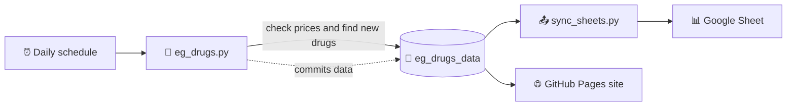

<div align="center">

# 💊 EgyptMeds

### A self-updating Egyptian drug price tracker and search site

*Names, active ingredients and prices. Checked every day. Searchable in English and Arabic.*


**[🔎 Open the search site](https://abdelmaksoud-ph.github.io/EgyptMeds/)**

</div>

---

## ✨ What it does

| | |
|---|---|
| 🔄 **Updates itself** | It wakes up every day, checks every product's price and hunts for new ones. |
| 📈 **Remembers prices** | Every change is logged with the old price, the new price and the date. |
| 🆕 **Spots new drugs** | New products are saved the day they appear. |
| 🔎 **Smart search** | Type the start of a word, use wildcards, filter by price. |
| 🌍 **English and Arabic** | One tap flips the whole site, including right-to-left layout. |
| 📊 **Google Sheets mirror** | Everything is also synced to a Sheet you can browse or share. |

## 🔎 Searching

| You type | You get |
|---|---|
| `keto` | Anything with a word starting with *keto* |
| `amox*cl` | `*` stands for any letters, so *Amoxicillin + Clavulanate* matches |
| `para 500` | Both words must match, in any order |
| `<50` | Price up to 50 |
| `>100` | Price from 100 |
| `20-50` | Price between 20 and 50 |
| `para* <30` | Words and price together |

Use the buttons under the search bar to search only the name or only the active ingredient. Click any result to see its full information and price history.

## ⚙️ How it works



1. The workflow runs `eg_drugs.py --auto`.
2. Fresh data is written to `eg_drugs_data/` and committed back to the repo.
3. `sync_sheets.py` copies the same data into Google Sheets.
4. The site (`index.html`) reads the CSV files and updates automatically.

## 🗂️ What's inside

```text
EgyptMeds/
├── 🌐 index.html              The search website
├── 🐍 eg_drugs.py             Collector: prices, details, new products
├── 📤 sync_sheets.py          Pushes data into Google Sheets
├── 📁 eg_drugs_data/
│   ├── products.json          All known products
│   ├── drug_details.json      Name, price, information, category
│   ├── drug_details.csv       Same data, used by the website
│   ├── price_history.csv      Every price change
│   ├── new_products.csv       Newly discovered products
│   └── changed_products.csv   Price and information changes
└── ⚙️ .github/workflows/
    └── update.yml             The daily schedule
```

## 🚀 Setup in 5 steps

1. **Fork or upload** this repo and keep it **public** (free unlimited Action minutes).
2. **Google service account:** enable the Sheets API and Drive API, then create a JSON key.
3. **Share a Google Sheet** with the service account's email as **Editor**.
4. **Add two secrets** in *Settings → Secrets and variables → Actions*:
   - `GOOGLE_CREDENTIALS`: the whole JSON key
   - `SHEET_ID`: the ID from the Sheet's URL
5. **Turn on Pages** in *Settings → Pages*, with branch `main` and folder `/ (root)`. Then run the workflow once from the **Actions** tab.

> ⚠️ Never commit the JSON key file. Keep it only in the secret.

## 🛠️ Handy commands

```bash
# Interactive menu: update, search, export, stats
python eg_drugs.py

# Full automatic update, as the daily workflow does
python eg_drugs.py --auto
```

## ❓ FAQ

<details>
<summary><b>The first run takes hours. Is that normal?</b></summary>

Yes. Every product is checked one at a time with a short pause, so a full run can take several hours. You can close your computer, since it runs on GitHub's servers. A single job stops after 6 hours.
</details>

<details>
<summary><b>Why is Price changes empty?</b></summary>

History starts from your first run. It fills in when a later run finds a different price.
</details>

<details>
<summary><b>Where does the active ingredient come from?</b></summary>

From the first line of each drug's information text (for example, "About Ketotifen"). If a drug's text doesn't start that way, the field stays blank.
</details>

## ⚖️ Disclaimer

This project is for information only and is **not medical advice**. Prices and details come from a third-party source and may be out of date or wrong. Always confirm with a pharmacist or doctor before taking any medicine.

---

<div dir="rtl">

## 🇪🇬 نبذة بالعربية

**EgyptMeds** موقع بحث عن الأدوية في مصر. يعرض اسم الدواء والمادة الفعالة والسعر، ويتحدّث تلقائيًا كل يوم.

- 🔎 ابحث بالاسم الكامل أو ببداية الكلمة أو استخدم `*` بدل أي حروف، مثل `amox*cl`
- 💰 فلتر الأسعار: `<50` أو `>100` أو `20-50`
- 📈 سجل تغيّر الأسعار وقائمة الأدوية الجديدة
- 🌍 الموقع يعمل بالعربية والإنجليزية بضغطة واحدة

⚠️ المعلومات للاستخدام العام فقط وليست نصيحة طبية. استشر الصيدلي أو الطبيب دائمًا قبل استخدام أي دواء.

</div>

<div align="center">

Made with 💚 and a lot of tiny HTTP requests

</div>
